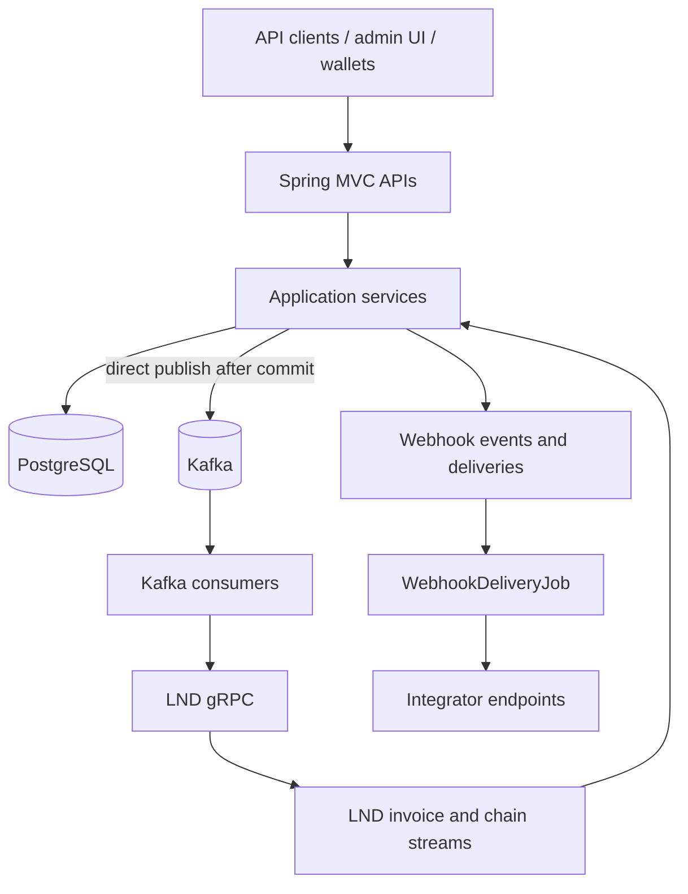
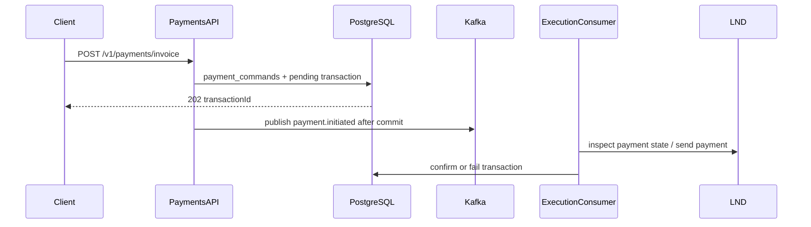

# Aratiri

Aratiri is a Spring Boot service that gives a custodial platform a Bitcoin Lightning and on-chain API surface without making Aratiri the custodian. The platform that embeds Aratiri still owns user balances and user relationships. Aratiri owns the operational bridge to LND, the user-facing payment APIs, the internal ledger projection, asynchronous payment execution, LNURL support, webhook delivery, and node administration.

This README focuses on how the application works. Operational setup lives in:

- [Running Aratiri](docs/running.md)
- [Configuration Reference](docs/configuration.md)
- [Deployment Runbook](ops/DEPLOYMENT.md)
- [Deployment Topology and Service Extraction ADR](docs/adr/0006-deployment-topology-and-service-extraction.md)
- [Trusted Issuer Local Testing](docs/trusted-issuers-local-testing.md)
- [Postman Collection](postman/README.md)

## System Shape

Aratiri is a modular monolith. The HTTP controllers are thin adapters over application ports. Domain/application services write durable intent into PostgreSQL first, then publish domain events directly to Kafka after the DB commit to drive side effects. LND payment calls are not made from HTTP request threads; dedicated Kafka consumers execute them with retry-topic backoff and dead-lettering.

The key design point is separation of concerns:

- HTTP requests validate identity and record intent.
- PostgreSQL stores user state, append-only accounting facts, payment idempotency keys, and webhook delivery state.
- Kafka carries committed domain events to consumers; a send failure after commit is logged and repaired by consumer-side idempotency and `TransactionReconciliationJob`.
- Execution consumers run LND payments with retry-topic backoff; exhausted retries land in the dead-letter topic, which emits a `node_operation.unknown_outcome` webhook.
- Scheduled jobs handle reconciliation, webhook delivery, stream reconnects, price-cache warm-refresh, and optional peer management.

Domain events (`invoice.settled`, `internal.transfer.initiated`, `internal.transfer.completed`,
`internal.invoice.cancel`, `payment.sent`, `payment.initiated`, `onchain.payment.initiated`,
`onchain.transaction.received`, `webhook.event.created`, `payment-request.provision.requested`,
`payment-request.cancel.requested`, `email.requested`) are published after commit with
deterministic keys, and consumers are idempotent under redelivery. Webhook event creation, the
payment-request saga, and email delivery are all Kafka-driven: business code records durable intent
in PostgreSQL, then consumers run the side effects (webhook row + delivery creation, LND
`AddInvoice`/cancel, SMTP) off the request threads.

## Runtime Modules

The source tree is organized by bounded area under `src/main/java/com/aratiri`.

| Area | Responsibility |
| --- | --- |
| `auth` | Local auth, Google SSO, trusted issuer token exchange, refresh tokens, password reset, user provisioning, WebSocket notification identity. |
| `accounts` | One account per user, LNURL alias, node-owned on-chain deposit address, QR payloads, fiat-denominated balance views. |
| `invoices` | Creates LND invoices, persists local invoice records, decodes payment requests, emits invoice-created webhooks. |
| `requests` | Shareable single-use fixed-satoshi Lightning payment links backed by local invoices and the existing settlement path; create/cancel are asynchronous (`202`) and provisioned/cancelled by a Kafka-driven saga with a scheduled-job backstop. |
| `payments` | Idempotent Lightning, LNURL, and on-chain payment commands. Creates pending debit transactions and emits payment intent events. |
| `transactions` | Transaction read model, append-only lifecycle events, settlement processors, account ledger updates, payment succeeded/failed events. |
| `lnurl` | Public LNURL-pay metadata/callback endpoints and authenticated LNURL-pay execution. |
| `decoder` | Resolves LNURL, Lightning invoices, on-chain addresses, internal aliases, Lightning addresses, npub, and NIP-05 identifiers. |
| `webhooks` | Consumes `webhook.event.created` to build idempotent webhook events, subscribes endpoints to event types, signs and retries deliveries. |
| `admin` | LND node administration, channel and peer operations, wallet/node stats, node settings. |
| `infrastructure` | JPA entities/repositories, Kafka, gRPC stubs, scheduling, filters, security, CORS, cache, WebSocket, and shared runtime configuration. |

Most modules follow a ports-and-adapters style: API classes call `application.port.in` interfaces, application services call `application.port.out` interfaces, and infrastructure adapters implement those ports with JPA repositories, LND gRPC clients, Kafka, HTTP clients, or external APIs.

## Core Data Model

Aratiri's money model is intentionally append-oriented.

- `users` and `accounts` represent identities and the single account attached to each user.
- `transactions` represent user-visible money movement intent and expose denormalized `current_*` fields for fast reads.
- `transaction_events` records lifecycle facts such as `PENDING`, `COMPLETED`, `FAILED`, and `FEE_ADDED`.
- `account_entries` is the append-only ledger. Each balance-affecting settlement appends a delta and resulting `balance_after`.
- `lightning_invoices` links LND invoices to Aratiri users, metadata, external references, payment hashes, and settlement state.
- `payment_commands` stores HTTP idempotency state by user and idempotency key.
- `webhook_events` and `webhook_deliveries` store integrator callbacks and retry state.

This means retries should be safe at each layer: domain events are published once per commit but consumers are idempotent under redelivery (the transaction row is the execution anchor), ledger entries are idempotent per account/transaction, routing fee events are unique per transaction, and payment commands replay accepted responses.

## Payment Lifecycle

### External Lightning Payment

1. A client calls `POST /v1/payments/invoice` with an `Idempotency-Key`.
2. `PaymentsAdapter` decodes the BOLT11 invoice, rejects already-paid or in-flight payment hashes, creates a pending `LIGHTNING_DEBIT` transaction, and publishes a `payment.initiated` event right after the commit.
3. `LightningPaymentExecutionConsumer` checks LND for existing payment state (never sending twice), then calls `Router.SendPaymentV2` through `LightningNodeClientAdapter`.
4. On success, the consumer records the routing fee if present, confirms the transaction, and appends a debit ledger entry, which emits payment/webhook/notification events.
5. On a terminal LND failure, it fails the transaction.
6. On an ambiguous transport failure or nonterminal LND state, it throws and the retry-topic machinery backs off and redelivers. After max attempts the message is dead-lettered and a `node_operation.unknown_outcome` webhook is emitted.

### Internal Lightning Transfer

If the payment hash belongs to an invoice generated by Aratiri, the payment is treated as an internal transfer instead of routing through LND:

1. The sender gets a pending `LIGHTNING_DEBIT` transaction.
2. An `internal.transfer.initiated` event is published.
3. `InternalTransferConsumer` settles the sender debit and creates a receiver `LIGHTNING_CREDIT`.
4. The internal invoice is marked settled locally.
5. A follow-up event cancels the LND invoice so it cannot also be paid externally.
6. Sender and receiver notifications are emitted.

### On-Chain Withdrawal

`POST /v1/payments/onchain` follows the same idempotency and direct-publish pattern. The API estimates network and platform fees, creates a pending `ONCHAIN_DEBIT`, and emits `onchain.payment.initiated`. `OnChainSendExecutionConsumer` broadcasts via LND `SendCoins` with a transaction label, then confirms the transaction and debits the ledger. On redelivery the consumer first looks the label up in the wallet and confirms without re-broadcasting.

### Payment Requests (shareable links)

Payment-request create/cancel are asynchronous by contract: every newly created request returns
`202` + `Location` and commits durable `PROVISIONING` intent (the synchronous `201` fast path was
removed). The saga is driven by Kafka:

1. Create commits the preimage/payment-hash and publishes `payment-request.provision.requested`.
2. `PaymentRequestProvisionConsumer` looks up by payment hash, calls LND `AddInvoice` only if absent, and finalizes `OPEN`.
3. Cancel durably transitions payable requests to `CANCEL_PENDING` (hiding BOLT11) and publishes `payment-request.cancel.requested`.
4. `PaymentRequestCancelConsumer` performs the LND lookup/cancel and finalizes `CANCELLED`.
5. `PaymentRequestSagaJob` remains as the lease-safe backstop: if the event was lost at publish, the consumer never ran, or a claim was crashed, the job reclaims `PROVISIONING`/`CANCEL_PENDING` rows on the same fenced lease rules and remains the terminal-state authority (`FAILED` after max attempts).

LND is never called from payment-request HTTP threads. `PAID` wins over every other stored status
when LND proves settlement; `EXPIRED` is derived only from `OPEN`.

### Incoming Funds

Incoming Lightning and on-chain credits come from LND streams.

- `LightningListener` subscribes to LND invoices from the stored add/settle cursor. Settled local invoices update `lightning_invoices`, then emit `invoice.settled`.
- `InvoiceSettledConsumer` creates or reuses the matching `LIGHTNING_CREDIT` settlement and appends the account ledger credit.
- `OnChainTransactionListener` subscribes to LND chain transactions from the stored block-height cursor. Confirmed outputs to account deposit addresses emit `onchain.transaction.received`.
- `OnChainTransactionConsumer` settles `ONCHAIN_CREDIT` transactions by tx hash and output index.

## API Surface

| API | Main purpose |
| --- | --- |
| `/v1/auth` | Login, registration verification, Google SSO, refresh, token exchange, logout, password reset, current user. |
| `/v1/accounts` | Current account, account lookup, account creation, legacy date-range transaction list. |
| `/v1/invoices` | Authenticated invoice creation and invoice decode. |
| `/v1/payment-requests` | Authenticated create/list/detail/cancel for shareable single-use Lightning payment links. |
| `/r/{publicId}` | Public unauthenticated payment-request lookup (safe fields only; `Cache-Control: no-store`). |
| `/v1/payments` | Idempotent Lightning and on-chain payment initiation plus on-chain fee estimates. |
| `/v1/transactions` | User-scoped transaction reads with cursor pagination and admin-only manual confirmation. |
| `/.well-known/lnurlp/{alias}` and `/lnurl/callback/{alias}` | Public LNURL-pay metadata and callback endpoints. |
| `/v1/lnurl/pay` | Authenticated LNURL-pay execution. |
| `/v1/decoder` | Unified decoding/resolution endpoint. |
| `/v1/general-data` | Supported fiat currencies and cached BTC price data. |
| `/v1/admin` | Admin-only LND node, channel, peer, wallet, settings, and stats endpoints. |
| `/v1/admin/webhooks` | Admin webhook endpoint management. |
| `/v1/admin/webhook-deliveries` | Webhook delivery inspection and manual retry. |
| `/v1/admin/payment-request-sagas` | Payment-request saga queue status, failed/exhausted-cancellation inspection, and manual retry. |
| `POST /v1/notifications/ws-ticket` | Authenticated mint of a short-lived single-use WebSocket ticket. |
| `/v1/notifications/subscribe` | WebSocket notification stream; present ticket via `Sec-WebSocket-Protocol: aratiri.notifications.v1, <ticket>` (no query auth). |

OpenAPI is generated at `/swagger-ui.html` only when API docs are explicitly enabled with `ARATIRI_SECURITY_API_DOCS_ENABLED=true`.
The H2 console is only permitted in `dev`, `development`, or `test` profiles unless `aratiri.security.dev-endpoints.h2-console-enabled=true` is set explicitly.

## Webhook Model

Webhook events are created by `WebhookEventConsumer` from `webhook.event.created` messages that business code publishes after its transaction commits (webhook row creation no longer runs in the business transaction). Each event has a deterministic `event_key`, and the `webhook_events` unique index makes duplicate processing idempotent — redelivery does not create duplicate callbacks. The `webhook_events`/`webhook_deliveries` tables remain the delivery and audit store; the admin `webhook.test` endpoint creates its event synchronously. Admin users create endpoints, select event types, rotate signing secrets, send test events, and inspect deliveries.

Supported event families include:

- `invoice.created`
- `invoice.settled`
- `payment.accepted`
- `payment.succeeded`
- `payment.failed`
- `onchain.deposit.confirmed`
- `account.balance_changed`
- `node_operation.unknown_outcome`
- `webhook.test`

Deliveries are signed with `X-Aratiri-Signature` using HMAC-SHA256 over `timestamp.eventId.payload`. `WebhookDeliveryJob` claims due deliveries, sends them without following redirects, records response status/body, and retries with backoff until max attempts.

## Reliability Boundaries

Aratiri publishes domain events directly to Kafka after the DB commit and relies on idempotent consumers for redelivery safety:

1. **Execution consumers** retry LND side effects through the Kafka retry-topic machinery (backoff, max attempts) and surface exhausted attempts as `node_operation.unknown_outcome` webhook events instead of pretending success or failure.
2. **Webhook delivery** retries outbound HTTP callbacks independently of the core payment flow.

Webhook event creation, payment-request saga provisioning/cancellation, and email send are also
consumer-driven: each has `@RetryableTopic` backoff, and each is at-most-once at the boundary
(dead-lettered records are logged). Webhook events dedupe on the unique `event_key`,
`PaymentRequestSagaJob` backstops lost saga events, and register/reset codes stay in the DB so
a lost email can be re-requested.

`TransactionReconciliationJob` also scans older pending Lightning transactions and compares them with LND payment state. This provides a repair path if a payment result was missed by the normal worker path.

## Security Model

The app is stateless at the HTTP layer and uses Spring Security as an OAuth2 resource server. It can validate locally issued HMAC JWTs and configured trusted issuer JWTs through a chained decoder.

Authentication flows include:

- local email/password login with refresh tokens,
- registration and password reset verification codes delivered by email (`email.requested` → `EmailConsumer`; the unconfigured-SMTP `503` is preserved, and register/reset responses no longer wait on SMTP),
- Google SSO provisioning,
- trusted issuer token exchange for integrators,
- role hierarchy `SUPERADMIN > ADMIN > VIEWER > USER`.

Public routes are limited to login/registration/reset, Google SSO, token refresh/exchange, LNURL metadata/callbacks, Swagger, H2 console, and notification WebSocket handshake. Admin controllers use method security with admin roles.

## External Dependencies

Aratiri expects:

- LND gRPC with admin macaroon credentials,
- PostgreSQL with Flyway-managed schema,
- Kafka for asynchronous domain events,
- SMTP for verification and password reset email,
- optional Google OAuth verification,
- optional Nostr relay and NIP-05/LUD16 lookups,
- external BTC price APIs with fallback pricing.

Generated LND protobuf classes are built from `src/main/proto` and packaged into the Spring Boot jar. The checked-in proto sources target LND `v0.18.5-beta`, declared as `lndProtoVersion` in `gradle.properties` and repeated in each proto file header. The Gradle `check` lifecycle runs `verifyLndProtoSources` to fail on version-header or checksum drift, and `verifyProtoClassesInBootJar` to ensure the generated `lnrpc`, `routerrpc`, and `invoicesrpc` classes are present in the boot jar.

## License

This project is licensed under the MIT License — see [LICENSE](LICENSE) for details.
